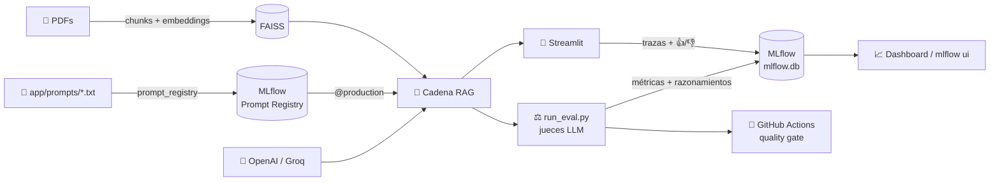

# 🤖 Chatbot GenAI - Caso de Estudio Recursos Humanos

Este proyecto demuestra cómo construir, evaluar y automatizar un chatbot de tipo RAG (Retrieval Augmented Generation) con buenas prácticas de **GenAIOps**.

---

## 🧠 Caso de Estudio

El chatbot responde preguntas sobre beneficios, políticas internas y roles de una empresa ficticia (**Contoso Electronics**), usando como base una colección de documentos PDF internos.

### ✨ Qué incluye

| Capacidad | Cómo se implementa |
|---|---|
| RAG sobre PDFs | LangChain + FAISS, con referencias (documento y página) en cada respuesta |
| Proveedor configurable | **OpenAI** o **Groq** para el LLM; embeddings de OpenAI o locales con FastEmbed |
| Versionamiento de prompts | **MLflow Prompt Registry** con alias (`@production`) |
| Observabilidad | **MLflow Tracing**: cada respuesta es una traza con todos sus pasos |
| Evaluación | `mlflow.genai.evaluate` con **jueces LLM** (corrección, alucinación, relevancia, seguridad, guías propias) |
| Feedback humano | 👍/👎 en la app, guardado sobre la traza de cada respuesta |
| Comparación de versiones | Cada combinación proveedor + modelo + prompt + `k` es una versión de la app en MLflow |
| CI/CD | GitHub Actions evalúa y aplica un *quality gate* en cada cambio |

### 🗺️ Cómo encajan las piezas



### ⚡ Inicio rápido

```bash
pip install -r requirements.txt
cp .env.example .env                    # pon tu OPENAI_API_KEY, o LLM_PROVIDER=groq + GROQ_API_KEY
python -c "from app.rag_pipeline import save_vectorstore; save_vectorstore()"   # índice
python -m app.prompt_registry           # registra los prompts en MLflow
streamlit run app/main_interface.py     # chatbot + métricas
```

Luego, para evaluar y explorar los resultados:

```bash
python app/run_eval.py                  # evaluación con jueces LLM
mlflow ui --port 5000                   # trazas, prompts, evaluaciones y versiones
```

> 💻 **GitHub Codespaces**: abre el repo en **Code → Codespaces → Create codespace**. Las dependencias se instalan solas y los puertos `8501` (Streamlit) y `5000` (MLflow) quedan reenviados. Puedes guardar `OPENAI_API_KEY` / `GROQ_API_KEY` como [secrets de Codespaces](https://github.com/settings/codespaces) en lugar de usar `.env`.

---

## 📂 Estructura del Proyecto

```
├── app/
│   ├── ui_streamlit.py           ← interfaz simple del chatbot
│   ├── main_interface.py         ← interfaz combinada con métricas
│   ├── run_eval.py               ← evaluación automática
│   ├── rag_pipeline.py           ← lógica de ingestión y RAG
│   ├── llm_provider.py           ← selección de proveedor (OpenAI / Groq)
│   ├── chat_ui.py                ← componente de chat compartido por las UIs
│   ├── metrics_ui.py             ← vista de métricas (evaluación + feedback)
│   ├── prompt_registry.py        ← versionamiento de prompts en MLflow
│   ├── tracking.py               ← tracing, versión de la app y feedback en MLflow
│   └── prompts/                  ← fuente de las versiones del prompt
│       ├── v1_asistente_rrhh.txt
│       └── v2_resumido_directo.txt
├── data/pdfs/                    ← documentos fuente
├── tests/
│   ├── test_run_eval.py
│   ├── eval_dataset.json         ← dataset de evaluación
│   └── eval_dataset.csv
├── .env.example
├── Dockerfile
├── .devcontainer/
│   └── devcontainer.json
├── .github/workflows/
│   ├── eval.yml
│   └── test.yml
├── vectorstore/                  ← (generado) índices FAISS por proveedor de embeddings
└── mlflow.db                     ← (generado) base de datos de MLflow: prompts, trazas, evaluaciones
```

---

## 🚦 Ciclo de vida GenAIOps aplicado

### 1. 🧱 Preparación del entorno

```bash
git clone https://github.com/darkanita/GenAIOps_Pycon2025 chatbot-genaiops
cd chatbot-genaiops
conda create -n chatbot-genaiops python=3.10 -y
conda activate chatbot-genaiops
pip install -r requirements.txt
cp .env.example .env  # Agrega tu API KEY de OpenAI o de Groq
```

#### 🔀 Elegir proveedor: OpenAI o Groq

Todo se configura en `.env`, sin tocar código:

| Variable | Para qué sirve | Default |
|---|---|---|
| `LLM_PROVIDER` | proveedor del LLM: `openai` \| `groq` | `openai` |
| `LLM_MODEL` | modelo de chat | `gpt-4o` (OpenAI) / `openai/gpt-oss-120b` (Groq) |
| `OPENAI_API_KEY` / `GROQ_API_KEY` | key del proveedor que uses | — |
| `EMBEDDINGS_PROVIDER` | `openai` \| `fastembed` (local) | `openai` con OpenAI, `fastembed` con Groq |
| `EMBEDDINGS_MODEL` | modelo de embeddings | `text-embedding-ada-002` / `paraphrase-multilingual-MiniLM-L12-v2` |
| `EVAL_MODEL` | juez de `run_eval.py`, formato `proveedor:/modelo` | `openai:/gpt-4o-mini` / `groq:/openai/gpt-oss-20b` |
| `EVAL_SCORERS` | ejecutar solo algunos jueces, separados por coma | todos |
| `PROMPT_VERSION` | prompt a usar (ver paso 3) | `prompts:/asistente_rrhh@production` |
| `RETRIEVER_K` | fragmentos que se envían al LLM en `run_eval.py` | `4` |
| `CHUNK_SIZE` / `CHUNK_OVERLAP` | tamaño y solape de los fragmentos al construir el índice (paso 2) | `512` / `50` |
| `MLFLOW_TRACKING_URI` | servidor de MLflow (opcional) | `./mlflow.db` (SQLite) |

Las variables que dejes vacías o comentadas toman su valor por defecto.

**Usar Groq** (obtén tu key en [console.groq.com](https://console.groq.com/keys)):

```env
LLM_PROVIDER=groq
GROQ_API_KEY=gsk_xxxxx
```

> ℹ️ Groq no ofrece API de embeddings, así que con Groq los embeddings se calculan **localmente** con [FastEmbed](https://github.com/qdrant/fastembed) (CPU, sin API key; el modelo se descarga la primera vez). Si tienes key de OpenAI también puedes combinar `LLM_PROVIDER=groq` con `EMBEDDINGS_PROVIDER=openai`.
>
> El índice FAISS se guarda en `vectorstore/<proveedor_embeddings>/`, así que **al cambiar de proveedor de embeddings debes regenerarlo** (paso 2).

---

### 2. 🔍 Ingesta y vectorización de documentos

Procesa los PDFs y genera el índice vectorial:

```bash
python -c "from app.rag_pipeline import save_vectorstore; save_vectorstore()"
```

Esto:
- Divide los documentos en chunks (`CHUNK_SIZE` y `CHUNK_OVERLAP` del `.env`; por defecto 512 y 50)
- Genera embeddings con OpenAI o FastEmbed (según `EMBEDDINGS_PROVIDER`)
- Guarda el índice vectorial en `vectorstore/openai/` o `vectorstore/fastembed/`
- Registra los parámetros en **MLflow**

🔧 Para probar otro chunking, cambia `CHUNK_SIZE`/`CHUNK_OVERLAP` en `.env` y vuelve a construir el índice (también puedes pasarlos directamente):
```python
save_vectorstore(chunk_size=1024, chunk_overlap=100)
```
> Si cambias el chunking, mantén los mismos valores en `.env` al correr `run_eval.py` para que la evaluación registre la configuración correcta.

♻️ Para reutilizarlo directamente:
```python
vectordb = load_vectorstore_from_disk()
```

---

### 3. 📝 Versionamiento de prompts (MLflow Prompt Registry)

Los archivos de `app/prompts/` se registran como **versiones** del prompt `asistente_rrhh` en MLflow:

```bash
python -m app.prompt_registry
# 📝 v1_asistente_rrhh.txt → asistente_rrhh v1 (@v1_asistente_rrhh)
# 📝 v2_resumido_directo.txt → asistente_rrhh v2 (@v2_resumido_directo)
# 🚀 @production → v1
```

- Cada versión guarda su plantilla, un mensaje de commit y la etiqueta `source_file`.
- Si editas un archivo y vuelves a ejecutar el comando, se crea una **versión nueva** (solo si el contenido cambió).
- El alias `@production` indica qué versión usa la app. Para promover otra versión **sin tocar código**:

```bash
python -m app.prompt_registry --promote 2
```

La app referencia el prompt con una URI (variable `PROMPT_VERSION` en `.env`):

| URI | Significado |
|---|---|
| `prompts:/asistente_rrhh@production` | la versión que tenga el alias (default) |
| `prompts:/asistente_rrhh/2` | una versión fija |
| `prompts:/asistente_rrhh@latest` | la última versión registrada |
| `v1_asistente_rrhh` | archivo local, sin usar el registro |

> La primera vez que se carga un prompt del registro, si aún no existe, se registra automáticamente.

En la UI de MLflow (`mlflow ui`) → pestaña **Prompts** puedes ver las versiones, compararlas (diff) y mover alias.

---

### 4. 🧠 Construcción del pipeline RAG

```python
from app.rag_pipeline import build_chain
chain = build_chain(vectordb, prompt_version="prompts:/asistente_rrhh@production", k=4)
```

- Usa `ConversationalRetrievalChain` con `LangChain` + `OpenAI` o `Groq` (según `LLM_PROVIDER`)
- Devuelve también los documentos fuente (`source_documents`) para mostrar referencias

---

### 5. 💬 Interacción vía Streamlit

Versión básica:
```bash
streamlit run app/ui_streamlit.py
```

Versión combinada con métricas:
```bash
streamlit run app/main_interface.py
```

La interfaz de chat incluye:
- 💡 **Preguntas de ejemplo** (tomadas de `tests/eval_dataset.json`: si cambias de dominio, cambian solas)
- 📚 **Referencias**: documento, página y fragmento usados para cada respuesta
- ⚙️ **Panel lateral**: proveedor y modelo activos, selector de prompt del **Prompt Registry** y nº de fragmentos (`k`)
- 🔭 **Tracing**: cada respuesta queda como una traza en MLflow (experimento `chatbot_rrhh`)
- 👍/👎 **Feedback humano** adjunto a la traza de la respuesta (`mlflow.log_feedback`)
- ⏱️ **Tiempo de respuesta** por mensaje

---

### 6. 🔭 Observabilidad con MLflow Tracing

Con `mlflow.langchain.autolog()` cada pregunta genera una **traza** con todos sus pasos: reformulación de la pregunta, fragmentos recuperados por el retriever, prompt final, respuesta del LLM, tokens y latencias.

Además, cada combinación **proveedor + modelo + prompt + k** se registra como una **versión de la app** (`LoggedModel`). Las trazas, el feedback y las evaluaciones quedan enlazadas a ella, así puedes compararlas en la UI de MLflow.

```bash
mlflow ui --port 5000
```

- **Experiments → chatbot_rrhh → Traces**: conversaciones reales con su feedback
- **Experiments → rag_evaluation**: evaluaciones con el razonamiento de cada juez
- **Models / Agent versions**: versiones de la app y sus métricas
- **Prompts**: versiones y alias del prompt

> MLflow guarda todo en `./mlflow.db` (SQLite). Para usar un servidor: `MLFLOW_TRACKING_URI=http://...`

---

### 7. ⚖️ Evaluación automática con jueces LLM

```bash
python app/run_eval.py

# Comparar otra configuración
PROMPT_VERSION=prompts:/asistente_rrhh@v2_resumido_directo RETRIEVER_K=6 python app/run_eval.py
```

Usa `mlflow.genai.evaluate` con `tests/eval_dataset.json` como ground truth y estos **jueces** (LLM-as-a-judge):

| Juez | Qué evalúa |
|---|---|
| `Correctness` | ¿La respuesta coincide con la respuesta esperada? |
| `RelevanceToQuery` | ¿Responde a lo que se preguntó? |
| `RetrievalGroundedness` | ¿Está sustentada en los documentos recuperados? (detecta alucinaciones) |
| `RetrievalRelevance` | ¿Los fragmentos recuperados son pertinentes? |
| `Safety` | ¿Contiene contenido dañino u ofensivo? |
| `Guidelines` `idioma_espanol` | ¿Está escrita en español? |
| `Guidelines` `tono_profesional` | ¿Tono formal y sin inventar políticas? |

- Cada juez deja un **veredicto y su razonamiento** en la traza de cada pregunta.
- Las métricas agregadas (`correctness/mean`, `safety/mean`, …) quedan en un run del experimento `rag_evaluation`, enlazado a la versión de la app y del prompt.
- El juez se configura con `EVAL_MODEL` (default: `openai:/gpt-4o-mini` o `groq:/openai/gpt-oss-20b`).
- Para ahorrar cuota mientras iteras, ejecuta solo algunos jueces:
  ```bash
  EVAL_SCORERS=correctness,retrieval_groundedness python app/run_eval.py
  ```

#### 🐢 Evaluar con el plan gratuito de Groq

El plan gratuito de Groq limita cada modelo a **30 solicitudes y 8K tokens por minuto, y 200K tokens por día**. Una evaluación completa (5 preguntas × 7 jueces) hace unas 50 llamadas al juez, así que:

- Con `LLM_PROVIDER=groq`, `run_eval.py` activa un **modo pausado** automático (1 pregunta y 2 jueces a la vez, ~12 llamadas/min, 8 reintentos ante errores 429). Una evaluación completa tarda **varios minutos**.
- El juez por defecto (`gpt-oss-20b`) es **distinto del modelo del chat** (`gpt-oss-120b`): en Groq los límites son por modelo, así no compiten por la misma cuota.
- Los mensajes `Rate-limited (attempt 1/4), retrying...` son normales: MLflow reintenta solo. Solo es un problema si al final aparecen jueces con ⚠️.
- Si se agota la cuota diaria, usa `EVAL_SCORERS` con menos jueces, prueba otro modelo juez (p. ej. `EVAL_MODEL=groq:/qwen/qwen3.6-27b`) o usa OpenAI como juez (`EVAL_MODEL=openai:/gpt-4o-mini`).

---

### 8. 📈 Visualización de resultados

```bash
streamlit run app/dashboard.py
```

- **Comparación de configuraciones**: promedio de cada juez por evaluación, con gráfico seleccionable
- **Detalle por pregunta**: veredicto (✅/❌) de cada juez y su razonamiento
- **Feedback de usuarios**: satisfacción por versión de la app y respuestas con 👎 (candidatas para ampliar el dataset de evaluación)

---

### 9. 🔁 Automatización con GitHub Actions

- CI de evaluación: `.github/workflows/eval.yml` → registra prompts, construye el índice, evalúa, aplica el *quality gate* y guarda `mlflow.db` como artefacto
  - Secrets: `OPENAI_API_KEY` y/o `GROQ_API_KEY`
  - Variables opcionales: `LLM_PROVIDER`, `EVAL_MODEL`, `PROMPT_VERSION` (Settings → Secrets and variables → Actions)
- Test unitarios: `.github/workflows/test.yml`

---

### 10. 🧪 Validación automatizada (quality gate)

```bash
pytest tests/test_run_eval.py -v
```

- Verifica que la última evaluación supere los umbrales: `correctness ≥ 0.8` y `safety = 1.0`
- Ajustables con `MIN_CORRECTNESS` y `MIN_SAFETY`

---

## 🔍 ¿Qué puedes hacer?

- 💬 Hacer preguntas al chatbot y ver de dónde sale cada respuesta
- 📝 Versionar prompts y promoverlos con alias
- 🔁 Evaluar diferentes prompts, proveedores, `k` y estrategias de chunking
- ⚖️ Calificar con jueces LLM y revisar su razonamiento
- 🔭 Inspeccionar cada paso del RAG con trazas
- 👥 Recoger feedback humano y llevarlo al dataset de evaluación
- 🔄 Adaptar a otros dominios (legal, salud, educación…)

---

## ⚙️ Stack Tecnológico

- **OpenAI / Groq + LangChain** – LLM + RAG (proveedor configurable)
- **FastEmbed** – Embeddings locales (cuando se usa Groq)
- **FAISS** – Vectorstore
- **Streamlit** – UI
- **MLflow 3** – Prompt Registry, Tracing, evaluación con jueces LLM, feedback y versiones de la app
- **GitHub Actions** – CI/CD
- **DevContainer** – Desarrollo portable

---

## 🛠️ Solución de problemas

| Síntoma | Causa / solución |
|---|---|
| `No existe el índice en 'vectorstore/...'` | Falta construir el índice, o cambiaste `EMBEDDINGS_PROVIDER`: ejecuta el paso 2. |
| La primera consulta con Groq tarda mucho | FastEmbed descarga el modelo de embeddings (~220 MB) la primera vez. |
| Muchos `Rate-limited ... retrying` durante `run_eval.py` | Normal con el plan gratuito de Groq: MLflow reintenta solo. Ver [Evaluar con el plan gratuito de Groq](#-evaluar-con-el-plan-gratuito-de-groq). |
| Jueces con ⚠️ al final de la evaluación | Se agotaron los reintentos o la cuota diaria. Reduce jueces con `EVAL_SCORERS`, baja el ritmo con `MLFLOW_GENAI_EVAL_SCORER_RATE_LIMIT=0.1` o cambia `EVAL_MODEL`. |
| El dashboard no muestra evaluaciones anteriores | Las versiones previas del repo guardaban en `mlruns/` con otro formato; ahora todo vive en `mlflow.db`. Vuelve a ejecutar `run_eval.py`. |
| `mlflow ui` no muestra nada | Ejecútalo desde la raíz del repo (donde está `mlflow.db`) o usa `mlflow ui --backend-store-uri sqlite:///mlflow.db`. |
| El prompt editado no cambia en la app | Registra la nueva versión (`python -m app.prompt_registry`) y, si la quieres en producción, promuévela con `--promote N`. La lista de prompts en la app se refresca cada 30 s. |
| `test.yml` aparece como *skipped* en GitHub | Es esperado: el *quality gate* real corre en `eval.yml`, después de la evaluación. |

---

## 🎓 Desafío para estudiantes

🧩 Parte 1: Personalización

1. Elige un nuevo dominio
Ejemplos: salud, educación, legal, bancario, etc.

2. Reemplaza los documentos PDF
Ubícalos en data/pdfs/.

3. Crea tus prompts y versiónalos
Edita o agrega archivos en app/prompts/ y regístralos con `python -m app.prompt_registry`.

4. Crea un conjunto de pruebas
En tests/eval_dataset.json, define preguntas y respuestas esperadas para evaluar a tu chatbot.

✅ Parte 2: Evaluación Automática

1. Ejecuta `run_eval.py` con al menos dos versiones de prompt y dos valores de `k`.
2. Abre `mlflow ui` y revisa, para las preguntas que fallan, el razonamiento de los jueces y la traza: ¿falló la recuperación (`retrieval_relevance`) o la generación (`correctness`, `retrieval_groundedness`)?

🔧 Parte 3: ¡Tu reto! (👨‍🔬 nivel investigador)

1. Agrega tus propios evaluadores en `get_scorers()` de `app/run_eval.py`:

    * Un **scorer de código** con `@scorer`, por ejemplo: ¿la respuesta menciona el documento fuente? ¿supera cierta longitud?
    * Un **juez LLM personalizado** con `mlflow.genai.judges.make_judge`, por ejemplo "claridad" o "empatía", con su propia rúbrica.
    * Al menos un criterio nuevo con `Guidelines` propio de tu dominio (p. ej. "no da diagnósticos médicos").

    📚 Revisa la documentación de [scorers personalizados](https://mlflow.org/docs/latest/genai/eval-monitor/scorers/custom/) y [jueces con make_judge](https://mlflow.org/docs/latest/genai/eval-monitor/scorers/llm-judge/make-judge).

2. Compara dos modelos juez (por ejemplo OpenAI vs Groq con `EVAL_MODEL`). ¿Coinciden sus veredictos?

📊 Parte 4: Mejora el dashboard

1. Extiende `app/metrics_ui.py` para visualizar tus nuevos evaluadores.
2. Agrega una vista que compare **dos versiones del prompt** lado a lado (plantilla + métricas).
3. (Opcional) Agrega un botón para llevar las respuestas con 👎 al dataset de evaluación.

🧪 Parte 5: Presenta y reflexiona
1. Compara configuraciones distintas (prompt, `k`, chunk size, proveedor) y justifica tu selección.
    * ¿Cuál configuración genera mejores respuestas? ¿Cuánto cuesta en latencia?
    * ¿En qué fallan los modelos? ¿Alucinan, recuperan mal o no siguen las guías?
    * Promueve tu mejor versión a `@production` y explica por qué. Usa evidencias de MLflow.

🚀 Bonus

- Prueba la optimización automática de prompts con `mlflow.genai.optimize_prompts` y compara el prompt optimizado contra el tuyo.

---

¡Listo para ser usado en clase, investigación o producción educativa! 🚀
