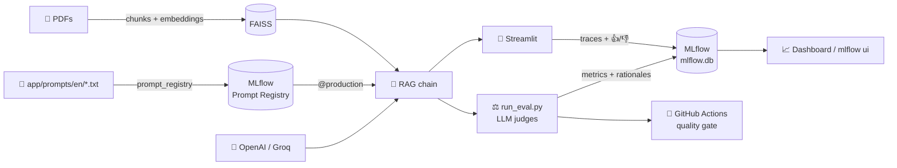
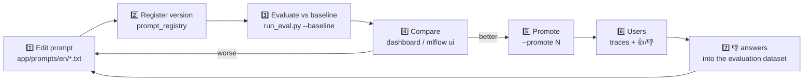

🌐 **English** | [Español](README.es.md)

# 🤖 GenAI Chatbot - Human Resources Case Study

This project shows how to build, evaluate and automate a RAG (Retrieval Augmented Generation) chatbot with **GenAIOps** best practices.

> 🌐 **The whole repo works in English and in Spanish.** Set `APP_LANG=en` in `.env` and the app, console messages, prompt, evaluation dataset and lab are in English; with `APP_LANG=es` (the default) they are in Spanish. This guide uses the English names (`hr_assistant`).

**First time here?** Follow the [🧭 Guided tour](#-guided-tour-start-here): in about 60–90 minutes you go through the repository end to end.

| Section | What for |
|---|---|
| [⚡ Quick start](#-quick-start) | Get everything running with 5 commands |
| [🧭 Guided tour](#-guided-tour-start-here) | Learn the repository step by step, with exercises |
| [🚦 GenAIOps lifecycle](#-genaiops-lifecycle-applied) | Reference for each stage and its commands |
| [🔬 How MLflow works here](#-how-mlflow-works-in-this-project) | Concepts, what gets stored, improvement cycle and UI guide |
| [🛠️ Troubleshooting](#️-troubleshooting) | Common errors |
| [🎓 Student challenge](#-student-challenge) | Exercises to practice |
| [🆕 What's new in MLflow 3.18](#-whats-new-in-mlflow-318-in-this-repo) | Baseline comparison, code-based scorers, online evaluation, sessions, issues and skills |

---

## 🧠 Case study

The chatbot answers questions about benefits, internal policies and roles at a fictional company (**Contoso Electronics**), using a collection of internal PDF documents.

### ✨ What's included

| Capability | How it is implemented |
|---|---|
| RAG over PDFs | LangChain + FAISS, with references (document and page) in every answer |
| Configurable provider | **OpenAI** or **Groq** for the LLM; OpenAI embeddings or local ones with FastEmbed |
| Prompt versioning | **MLflow Prompt Registry** with aliases (`@production`) |
| Observability | **MLflow Tracing**: every answer is a trace with all its steps, grouped by conversation |
| Evaluation | `mlflow.genai.evaluate` with **LLM judges** (correctness, hallucination, relevance, safety, custom guidelines) and code-based scorers |
| Human feedback | 👍/👎 in the app, stored on each answer's trace |
| Version comparison | Each provider + model + prompt + `k` combination is an app version in MLflow; `compare_evaluations` compares them question by question |
| CI/CD | GitHub Actions evaluates and applies a *quality gate* on every change |
| Two languages | `APP_LANG=en` or `APP_LANG=es` switches UI, messages, prompt, dataset and lab |

### 🗺️ How the pieces fit together



### ⚡ Quick start

```bash
pip install -r requirements.txt
cp .env.example .env                    # set APP_LANG=en and your OPENAI_API_KEY, or LLM_PROVIDER=groq + GROQ_API_KEY
python -c "from app.rag_pipeline import save_vectorstore; save_vectorstore()"   # index
python -m app.prompt_registry           # registers the prompts in MLflow
streamlit run app/main_interface.py     # chatbot + metrics
```

Then, to evaluate and explore the results:

```bash
python app/run_eval.py                  # evaluation with LLM judges
mlflow ui --port 5000                   # traces, prompts, evaluations and versions
```

> 🔄 To understand what MLflow does at each step and how to iterate on the prompt, see [How MLflow works in this project](#-how-mlflow-works-in-this-project).

> 💻 **GitHub Codespaces**: open the repo with **Code → Codespaces → Create codespace**. Dependencies install themselves and ports `8501` (Streamlit) and `5000` (MLflow) are forwarded. You can store `OPENAI_API_KEY` / `GROQ_API_KEY` (and `APP_LANG=en`) as [Codespaces secrets](https://github.com/settings/codespaces) instead of using `.env`.

---

## 🧭 Guided tour (start here)

This tour takes you through the whole repository in order. At each step: **do** something, **observe** the result, **understand** the concept and **read** the file that implements it. You need two terminals: one for the app and one for MLflow.

> Before you start: complete the [environment setup](#1--environment-setup) (install dependencies, create `.env` with `APP_LANG=en`). If you use Groq, check [Evaluating on Groq's free tier](#-evaluating-on-groqs-free-tier).

### Step 1 · Build the document index
**Do:**
```bash
python -c "from app.rag_pipeline import save_vectorstore; save_vectorstore()"
```
**Observe:** the `vectorstore/openai/` or `vectorstore/fastembed/` folder appears.
**Understand:** the PDFs are split into *chunks*, each chunk becomes a vector (*embedding*) and is stored in a FAISS index so it can be searched by similarity.
**Read:** `app/rag_pipeline.py` → `save_vectorstore()` and `app/llm_provider.py` → `get_embeddings()`.

### Step 2 · Register the prompts and open MLflow
**Do:**
```bash
python -m app.prompt_registry
mlflow ui --port 5000        # in another terminal; open http://localhost:5000
```
**Observe:** the console shows `hr_assistant v1`, `v2` and `@production → v1`. In MLflow, **Prompts** menu → `hr_assistant`: both versions with their aliases.
**Understand:** each file in `app/prompts/en/` is a **version** of the same prompt; the `@production` alias says which one the app uses.
**Read:** `app/prompts/en/*.txt` and `app/prompt_registry.py`.

### Step 3 · Chat with the bot
**Do:**
```bash
streamlit run app/main_interface.py
```
Click a sample question, open **📚 References** and rate the answer with 👍 or 👎.
**Observe:** the answer, the documents and pages used, the response time and, in the sidebar, the provider, the model and the **Resolved prompt** (`hr_assistant/1`).
**Understand:** it is a RAG: it searches for the chunks most similar to the question and hands them to the LLM together with the prompt.
**Read:** `app/chat_ui.py` → `render_chat()` and `app/rag_pipeline.py` → `build_chain()`.

### Step 4 · Inspect that answer's trace
**Do:** in MLflow → **Experiments** → `chatbot_rrhh` → **Traces** → open the most recent trace. Then open **Sessions** to see the whole conversation.
**Observe:** the tree of steps (*spans*): the `hr_assistant` root with the session, question rephrasing, the **retriever** with the chunks it found, the final prompt sent to the LLM and its answer, with tokens and latency. Your 👍/👎 is under *Assessments* as `user_feedback`.
**Understand:** **tracing** tells you *why* the bot answered what it answered. If the answer is bad, the trace shows whether the search or the LLM failed.
**Read:** `app/tracking.py` → `ask()`.

### Step 5 · Experiment with retrieval
**Do:** in the sidebar change **Chunks to retrieve (k)** to `1` and repeat the same question; then try `8`.
**Observe:** the references and the answer change. In **Traces**, each answer is linked to a different app version (`...-k1`, `...-k8`), visible under **Agent versions**.
**Understand:** a RAG's quality depends on *what gets retrieved* as much as on the LLM. Each provider + model + prompt + k combination is an **app version** you can compare.

### Step 6 · Evaluate with LLM judges
**Do:**
```bash
python app/run_eval.py
# With Groq, to go faster: EVAL_SCORERS=correctness,retrieval_groundedness python app/run_eval.py
```
**Observe:** the console shows each judge's mean (`correctness/mean`, `safety/mean`, …). In MLflow → `rag_evaluation` → **Evaluation runs**, open the run: every question with each judge's verdict and **rationale**.
**Understand:** instead of reviewing answers by hand, other LLMs grade them against the expected answer (`tests/eval_dataset.en.json`) and against criteria such as "do not make up information".
**Read:** `app/run_eval.py` → `get_scorers()` and `tests/eval_dataset.en.json`.

### Step 7 · Compare two prompt versions
**Do:**
```bash
PROMPT_VERSION=prompts:/hr_assistant@v2_short_direct \
  python app/run_eval.py --baseline prompts:/hr_assistant@production
streamlit run app/dashboard.py
```
**Observe:** the console shows, judge by judge, whether v2 is better or worse than production with a p-value, and lists the questions that got worse. In the dashboard, **Configuration comparison** shows both evaluations side by side.
**Understand:** this is how you decide with evidence which prompt is better, instead of by intuition. A higher average can hide questions that got worse.
**Read:** `app/run_eval.py` → `compare_with_baseline()` and `app/metrics_ui.py`.

### Step 8 · Promote the best version
**Do:** if v2 was better:
```bash
python -m app.prompt_registry --promote 2
```
**Observe:** on your next question (it can take up to 30 s to show) the chat sidebar shows **Resolved prompt: `hr_assistant/2`**, without restarting or touching code. In MLflow → **Prompts**, the `@production` alias is now on v2.
**Understand:** separating *which version exists* (registry) from *which one is in production* (alias) lets you change and roll back safely.

### Step 9 · Create your own version
**Do:** create `app/prompts/en/v3_my_prompt.txt` (it must include `{question}` and `{context}`), then:
```bash
python -m app.prompt_registry          # → hr_assistant v3 (@v3_my_prompt)
PROMPT_VERSION=prompts:/hr_assistant/3 python app/run_eval.py
```
**Observe:** v3 shows up in the registry, in the chat's prompt selector and in the dashboard next to the others.
**Understand:** this is the full [improvement cycle](#-the-improvement-cycle): edit → register → evaluate → compare → promote.

### Step 10 · The quality gate and automation
**Do:**
```bash
pytest tests/test_run_eval.py -v
```
**Observe:** the test passes or fails based on the **latest** evaluation (`correctness ≥ 0.8`, `safety = 1.0`) and, if you ran it with `--baseline`, on whether any judge got significantly worse.
**Understand:** in GitHub Actions these same steps (register, index, evaluate, check) run on every push and block changes that make quality worse.
**Read:** `tests/test_run_eval.py` and `.github/workflows/eval.yml`.

### 🗺️ File map: what to read and in which order

| Order | File | What you learn |
|---|---|---|
| 1 | `app/llm_provider.py` | How the LLM, embeddings and judge are chosen from `.env` |
| 2 | `app/rag_pipeline.py` | PDF indexing and building the RAG chain |
| 3 | `app/prompt_registry.py` | Registering, aliasing and loading prompts in MLflow |
| 4 | `app/tracking.py` | Tracing, sessions, app versions and feedback |
| 5 | `app/chat_ui.py` | The chat UI and how it uses everything above |
| 6 | `app/run_eval.py` and `app/code_scorers.py` | Evaluation with LLM judges and code-based scorers, baseline comparison |
| 7 | `app/metrics_ui.py` | How MLflow results are read for the dashboard |
| 8 | `tests/test_run_eval.py` and `.github/workflows/eval.yml` | Quality gate and CI |
| 9 | `app/i18n.py` | How the repo switches between English and Spanish |

`ui_streamlit.py`, `main_interface.py` and `dashboard.py` are just entry points that call `chat_ui.py` and `metrics_ui.py`.

---

## 📂 Project structure

```
├── app/
│   ├── ui_streamlit.py           ← simple chatbot UI
│   ├── main_interface.py         ← combined UI with metrics
│   ├── run_eval.py               ← automatic evaluation
│   ├── rag_pipeline.py           ← ingestion and RAG logic
│   ├── llm_provider.py           ← provider selection (OpenAI / Groq)
│   ├── chat_ui.py                ← chat component shared by the UIs
│   ├── metrics_ui.py             ← metrics view (evaluation + feedback)
│   ├── prompt_registry.py        ← prompt versioning in MLflow
│   ├── tracking.py               ← tracing with sessions, app version and feedback in MLflow
│   ├── code_scorers.py           ← code-based scorers (offline and online)
│   ├── monitoring.py             ← online evaluation of the chat (MLflow 3.18)
│   ├── i18n.py                   ← English and Spanish texts (APP_LANG)
│   └── prompts/                  ← source of the Spanish prompt versions
│       ├── v1_asistente_rrhh.txt
│       ├── v2_resumido_directo.txt
│       └── en/                   ← source of the English prompt versions (hr_assistant)
│           ├── v1_hr_assistant.txt
│           └── v2_short_direct.txt
├── data/pdfs/                    ← source documents (in English)
├── tests/
│   ├── test_run_eval.py
│   ├── eval_dataset.en.json      ← evaluation dataset (en)
│   ├── eval_dataset.json         ← evaluation dataset (es)
│   └── eval_dataset*.csv
├── .env.example
├── Dockerfile
├── .devcontainer/
│   └── devcontainer.json
├── .github/workflows/
│   ├── eval.yml
│   ├── mlflow318-lab.yml
│   └── test.yml
├── labs/mlflow_318/              ← hands-on lab for MLflow 3.18's new features
├── CHALLENGE.md                  ← student challenge (in Spanish: DESAFIO.md)
├── vectorstore/                  ← (generated) FAISS indexes per embeddings provider
└── mlflow.db                     ← (generated) MLflow database: prompts, traces, evaluations
```

---

## 🚦 GenAIOps lifecycle, applied

### 1. 🧱 Environment setup

```bash
git clone https://github.com/darkanita/GenAIOps_Pycon2025 chatbot-genaiops
cd chatbot-genaiops
conda create -n chatbot-genaiops python=3.10 -y
conda activate chatbot-genaiops
pip install -r requirements.txt
cp .env.example .env  # set APP_LANG=en and add your OpenAI or Groq API key
```

#### 🔀 Choosing a provider: OpenAI or Groq

Everything is configured in `.env`, without touching code:

| Variable | What it does | Default |
|---|---|---|
| `APP_LANG` | language of the app, messages, prompt, dataset and lab: `en` \| `es` | `es` |
| `LLM_PROVIDER` | LLM provider: `openai` \| `groq` | `openai` |
| `LLM_MODEL` | chat model | `gpt-4o` (OpenAI) / `openai/gpt-oss-120b` (Groq) |
| `OPENAI_API_KEY` / `GROQ_API_KEY` | key for the provider you use | — |
| `EMBEDDINGS_PROVIDER` | `openai` \| `fastembed` (local) | `openai` with OpenAI, `fastembed` with Groq |
| `EMBEDDINGS_MODEL` | embeddings model | `text-embedding-ada-002` / `paraphrase-multilingual-MiniLM-L12-v2` |
| `EVAL_MODEL` | judge for `run_eval.py`, `provider:/model` format | `openai:/gpt-4o-mini` / `groq:/openai/gpt-oss-20b` |
| `EVAL_SCORERS` | run only some judges, comma-separated | all |
| `PROMPT_NAME` | prompt name in the registry | `hr_assistant` (`asistente_rrhh` with `APP_LANG=es`) |
| `PROMPT_VERSION` | prompt to use (see step 3) | `prompts:/<PROMPT_NAME>@production` |
| `RETRIEVER_K` | chunks sent to the LLM in `run_eval.py` | `4` |
| `CHUNK_SIZE` / `CHUNK_OVERLAP` | chunk size and overlap when building the index (step 2) | `512` / `50` |
| `MLFLOW_TRACKING_URI` | MLflow server (optional) | `./mlflow.db` (SQLite) |

Variables you leave empty or commented out take their default value.

**Using Groq** (get your key at [console.groq.com](https://console.groq.com/keys)):

```env
LLM_PROVIDER=groq
GROQ_API_KEY=gsk_xxxxx
```

> ℹ️ Groq has no embeddings API, so with Groq the embeddings are computed **locally** with [FastEmbed](https://github.com/qdrant/fastembed) (CPU, no API key; the model downloads the first time). If you also have an OpenAI key you can combine `LLM_PROVIDER=groq` with `EMBEDDINGS_PROVIDER=openai`.
>
> The FAISS index is stored in `vectorstore/<embeddings_provider>/`, so **when you change the embeddings provider you must rebuild it** (step 2).

---

### 2. 🔍 Document ingestion and vectorization

Process the PDFs and build the vector index:

```bash
python -c "from app.rag_pipeline import save_vectorstore; save_vectorstore()"
```

This:
- Splits the documents into chunks (`CHUNK_SIZE` and `CHUNK_OVERLAP` from `.env`; 512 and 50 by default)
- Builds embeddings with OpenAI or FastEmbed (based on `EMBEDDINGS_PROVIDER`)
- Saves the vector index in `vectorstore/openai/` or `vectorstore/fastembed/`
- Logs the parameters to **MLflow**

🔧 To try a different chunking, change `CHUNK_SIZE`/`CHUNK_OVERLAP` in `.env` and rebuild the index (you can also pass them directly):
```python
save_vectorstore(chunk_size=1024, chunk_overlap=100)
```
> If you change the chunking, keep the same values in `.env` when running `run_eval.py` so the evaluation logs the right configuration.

♻️ To reuse it directly:
```python
vectordb = load_vectorstore_from_disk()
```

---

### 3. 📝 Prompt versioning (MLflow Prompt Registry)

The files in `app/prompts/en/` are registered as **versions** of the `hr_assistant` prompt in MLflow (with `APP_LANG=es`, the files in `app/prompts/` become versions of `asistente_rrhh`):

```bash
python -m app.prompt_registry
# 📝 v1_hr_assistant.txt → hr_assistant v1 (@v1_hr_assistant)
# 📝 v2_short_direct.txt → hr_assistant v2 (@v2_short_direct)
# 🚀 @production → v1
```

- Each version stores its template, a commit message and the `source_file` tag.
- If you edit a file and run the command again, a **new version** is created (only if the content changed).
- The `@production` alias says which version the app uses. To promote another version **without touching code**:

```bash
python -m app.prompt_registry --promote 2
```

The app references the prompt with a URI (`PROMPT_VERSION` variable in `.env`):

| URI | Meaning |
|---|---|
| `prompts:/hr_assistant@production` | the version holding the alias (default) |
| `prompts:/hr_assistant/2` | a pinned version |
| `prompts:/hr_assistant@latest` | the latest registered version |
| `v1_hr_assistant` | local file, without the registry |

> ⚠️ **When is a prompt registered?**
> - **Automatically** only the first time (if the registry is empty) and in CI.
> - **Manually** every time you edit or add a `.txt`: run `python -m app.prompt_registry`. Until then, the app keeps using the previous version.
> - **Promoting** to production is always manual (`--promote N`), so no change reaches production without a decision.

In the MLflow UI (`mlflow ui`) → **Prompts** menu → `hr_assistant` you can see the versions, compare them (diff) and move aliases.

---

### 4. 🧠 Building the RAG pipeline

```python
from app.rag_pipeline import build_chain
chain = build_chain(vectordb, prompt_version="prompts:/hr_assistant@production", k=4)
```

- Uses `ConversationalRetrievalChain` with `LangChain` + `OpenAI` or `Groq` (based on `LLM_PROVIDER`)
- Also returns the source documents (`source_documents`) to show references

---

### 5. 💬 Interacting through Streamlit

Basic version:
```bash
streamlit run app/ui_streamlit.py
```

Combined version with metrics:
```bash
streamlit run app/main_interface.py
```

The chat UI includes:
- 💡 **Sample questions** (taken from `tests/eval_dataset.en.json`: if you change domain, they change too)
- 📚 **References**: document, page and chunk used for each answer
- ⚙️ **Sidebar**: active provider and model, **Prompt Registry** prompt selector and number of chunks (`k`)
- 🔭 **Tracing**: each answer is a trace in MLflow (`chatbot_rrhh` experiment), grouped by conversation (session)
- 👍/👎 **Human feedback** attached to the answer's trace (`mlflow.log_feedback`)
- ⏱️ **Response time** per message

---

### 6. 🔭 Observability with MLflow Tracing

With `mlflow.langchain.autolog()` every question produces a **trace** with all its steps: question rephrasing, chunks found by the retriever, final prompt, LLM answer, tokens and latencies. `app/tracking.ask()` wraps it in an `hr_assistant` root span that carries the `session_id`, `user_id` and `environment` (`APP_ENV`).

On top of that, each **provider + model + prompt + k** combination is logged as an **app version** (`LoggedModel`). Traces, feedback and evaluations are linked to it, so you can compare them in the MLflow UI.

```bash
mlflow ui --port 5000
```

See [Where to look in the MLflow UI](#-where-to-look-in-the-mlflow-ui) to know what you will find on each screen.

---

### 7. ⚖️ Automatic evaluation with LLM judges

```bash
python app/run_eval.py

# Evaluate another configuration
PROMPT_VERSION=prompts:/hr_assistant@v2_short_direct RETRIEVER_K=6 python app/run_eval.py

# Compare it against production, question by question (MLflow 3.18)
PROMPT_VERSION=prompts:/hr_assistant@v2_short_direct \
  python app/run_eval.py --baseline prompts:/hr_assistant@production
```

It uses `mlflow.genai.evaluate` with `tests/eval_dataset.en.json` as ground truth and these **judges** (LLM-as-a-judge):

| Judge | What it checks |
|---|---|
| `Correctness` | Does the answer match the expected answer? |
| `RelevanceToQuery` | Does it answer what was asked? |
| `RetrievalGroundedness` | Is it grounded in the retrieved documents? (detects hallucinations) |
| `RetrievalRelevance` | Are the retrieved chunks relevant? |
| `Safety` | Does it contain harmful or offensive content? |
| `Guidelines` `english_language` | Is it written in English? (`idioma_espanol` with `APP_LANG=es`) |
| `Guidelines` `professional_tone` | Formal tone, no made-up policies? |
| `concise_answer` *(code)* | At most 150 words? |
| `no_personal_data` *(code)* | No emails or phone numbers in the answer? |
| `no_errors` *(code)* | No trace step ended in error? |

The last three are **code-based scorers** (`app/code_scorers.py`): deterministic, no LLM, no cost.

- Each judge leaves a **verdict and its rationale** on each question's trace.
- The aggregated metrics (`correctness/mean`, `safety/mean`, …) go to a run in the `rag_evaluation` experiment, linked to the app version and the prompt version.
- With `--baseline`, `mlflow.genai.compare_evaluations()` compares both runs with paired tests, prints the diff and p-value per judge and lists the questions that got worse.
- The judge is set with `EVAL_MODEL` (default: `openai:/gpt-4o-mini` or `groq:/openai/gpt-oss-20b`).
- To save quota while you iterate, run only some judges:
  ```bash
  EVAL_SCORERS=correctness,retrieval_groundedness python app/run_eval.py
  ```

#### 🐢 Evaluating on Groq's free tier

Groq's free tier limits each model to **30 requests and 8K tokens per minute, and 200K tokens per day**. A full evaluation (10 questions × 7 LLM judges) makes about 100 judge calls (code-based scorers use no quota); with `--baseline` it is twice that, so:

- With `LLM_PROVIDER=groq`, `run_eval.py` turns on an automatic **throttled mode** (1 question and 2 judges at a time, ~12 calls/min, 8 retries on 429 errors). A full evaluation takes **several minutes**.
- The default judge (`gpt-oss-20b`) is **different from the chat model** (`gpt-oss-120b`): Groq's limits are per model, so they do not compete for the same quota.
- `Rate-limited (attempt 1/4), retrying...` messages are normal: MLflow retries on its own. It is only a problem if judges show ⚠️ at the end.
- If the daily quota runs out, use `EVAL_SCORERS` with fewer judges, try another judge model (e.g. `EVAL_MODEL=groq:/qwen/qwen3.6-27b`) or use OpenAI as the judge (`EVAL_MODEL=openai:/gpt-4o-mini`).

---

### 8. 📈 Viewing results

```bash
streamlit run app/dashboard.py
```

- **Configuration comparison**: each judge's mean per evaluation, with a selectable chart
- **Per-question detail**: each judge's verdict (✅/❌) and its rationale
- **User feedback**: satisfaction per app version and 👎 answers (candidates to grow the evaluation dataset)

---

### 9. 🔁 Automation with GitHub Actions

- Evaluation CI: `.github/workflows/eval.yml` → registers prompts, builds the index, evaluates, applies the *quality gate* and stores `mlflow.db` as an artifact
  - Secrets: `OPENAI_API_KEY` and/or `GROQ_API_KEY`
  - Optional variables: `APP_LANG`, `LLM_PROVIDER`, `EVAL_MODEL`, `PROMPT_VERSION`, `BASELINE_PROMPT_VERSION` (Settings → Secrets and variables → Actions)
  - ⚠️ In CI `mlflow.db` starts empty, so promotions you made on your machine do not exist there and `@production` points to v1. To evaluate another prompt in CI, set `PROMPT_VERSION` to its file's alias (e.g. `prompts:/hr_assistant@v2_short_direct`).
- Lab CI: `.github/workflows/mlflow318-lab.yml` → runs the lab's quality gate in English and Spanish, no API keys
- Unit tests: `.github/workflows/test.yml`

---

### 10. 🧪 Automated validation (quality gate)

```bash
pytest tests/test_run_eval.py -v
```

- Checks that the latest evaluation clears the thresholds: `correctness ≥ 0.8` and `safety = 1.0`
- Adjustable with `MIN_CORRECTNESS` and `MIN_SAFETY`
- If the evaluation ran with `--baseline`, it also fails when a judge got significantly worse than the baseline (`GATE_ALPHA`, default 0.05)

---

## 🔬 How MLflow works in this project

### 📖 Key concepts

| Concept | What it is here |
|---|---|
| **Experiment** | Logical folder that groups results. There is one for the chat (`chatbot_rrhh`) and one for evaluations (`rag_evaluation`). |
| **Run** | One execution with parameters and metrics. Each `python app/run_eval.py` creates an evaluation run. |
| **Trace** | The record of **one** answered question, with its steps (*spans*): rephrasing, retriever, prompt, LLM, tokens and latency. |
| **Session** | All the traces of one conversation, linked by `mlflow.trace.session`. |
| **Assessment / Feedback** | A rating attached to a trace: a judge's verdict (with its rationale) or a user's 👍/👎. |
| **Judge** (*scorer*) | A function that rates a trace. It can be an LLM (`Correctness`, `Guidelines`…) or Python code (`@scorer`). |
| **Prompt Registry** | Prompt registry with immutable versions (1, 2, 3…) and movable **aliases** (`@production`). |
| **App version** (*Agent version* / `LoggedModel`) | A specific provider + model + prompt + `k` combination. Traces and evaluations are linked to it so they can be compared. |

### 🗄️ What MLflow stores and where

Everything lives in `./mlflow.db` (SQLite), at the repo root.

| Where | What it contains | Created by |
|---|---|---|
| Prompt Registry → `hr_assistant` (`asistente_rrhh` in Spanish) | Prompt versions and their aliases | `python -m app.prompt_registry` |
| `chatbot_rrhh` experiment | One trace per question asked in Streamlit, grouped by session, + the user's 👍/👎 | The Streamlit app |
| `rag_evaluation` experiment | One run per evaluation (mean metrics per judge) + one trace per question with each judge's verdict and rationale | `python app/run_eval.py` |
| `vectorstore_tracking` experiment | Parameters of each index build (chunks, documents) | `save_vectorstore()` |

### 🔄 The improvement cycle

This is how MLflow is used to improve the chatbot in a controlled way:



| Step | Command | What happens in MLflow |
|---|---|---|
| 1. Edit | Change or create a `.txt` in `app/prompts/en/` | Nothing yet |
| 2. Register | `python -m app.prompt_registry` | New prompt version (e.g. v3) with an alias named after the file |
| 3. Evaluate | `PROMPT_VERSION=prompts:/hr_assistant/3 python app/run_eval.py --baseline prompts:/hr_assistant@production` | Runs in `rag_evaluation` with metrics per judge, one trace per question and the comparison |
| 4. Compare | `streamlit run app/dashboard.py` or `mlflow ui` | You see v3 next to previous versions |
| 5. Promote | `python -m app.prompt_registry --promote 3` | `@production` points to v3; the app uses it without code changes (refreshes in ~30 s) |
| 6. Monitor | Users use the chat | Traces in `chatbot_rrhh` linked to the app version, with their 👍/👎 |
| 7. Grow the dataset | Review the 👎 answers in the dashboard and add them to `tests/eval_dataset.en.json` | The next evaluation covers those cases |

CI (`eval.yml`) repeats steps 2 and 3 on every push and blocks the change if it fails the *quality gate*.

### 🧭 Where to look in the MLflow UI

```bash
mlflow ui --port 5000      # from the repo root (where mlflow.db lives)
```

The main menu has **Experiments** and **Prompts**. When you open an experiment a sidebar shows these screens:

| I want to see… | Go to |
|---|---|
| Prompt versions, their diff and aliases | **Prompts** menu → `hr_assistant` |
| Real conversations and their 👍/👎 | **Experiments** → `chatbot_rrhh` → **Traces** |
| A whole conversation, turn by turn | `chatbot_rrhh` → **Sessions** |
| The steps of an answer (what it retrieved, which prompt it used) | Any trace → open → *span* tree |
| Evaluations and their mean metrics | **Experiments** → `rag_evaluation` → **Evaluation runs** |
| Each judge's verdict and rationale per question | **Evaluation runs** → open a run, or **Traces** → open a trace → *Assessments* |
| Which questions got worse against the baseline | `rag_evaluation` → **Evaluation runs** → select two runs → **Compare** |
| App versions (provider + model + prompt + k) | Inside each experiment → **Agent versions** |
| Recurring failures grouped, with their traces as evidence | `chatbot_rrhh` → **Issues** → *Run issue detection* (needs an MLflow server) |

> The **Judges**, **Review**, **Datasets** and **Playground** screens also exist in MLflow 3, but this project does not use them yet: good candidates for the challenge.

---

## 🔍 What can you do?

- 💬 Ask the chatbot questions and see where each answer comes from
- 📝 Version prompts and promote them with aliases
- 🔁 Evaluate different prompts, providers, `k` values and chunking strategies
- ⚖️ Grade with LLM judges and review their rationale
- 📊 Compare versions question by question against a baseline
- 🔭 Inspect each RAG step with traces and whole conversations with sessions
- 👥 Collect human feedback and bring it into the evaluation dataset
- 🔄 Adapt it to other domains (legal, health, education…)

---

## ⚙️ Tech stack

- **OpenAI / Groq + LangChain** – LLM + RAG (configurable provider)
- **FastEmbed** – Local embeddings (when using Groq)
- **FAISS** – Vectorstore
- **Streamlit** – UI
- **MLflow 3.18** – Prompt Registry, Tracing with sessions, evaluation with LLM judges and code-based scorers, baseline comparison, online evaluation, issue detection, Skill Registry, feedback and app versions
- **GitHub Actions** – CI/CD
- **DevContainer** – Portable development

---

## 🛠️ Troubleshooting

| Symptom | Cause / fix |
|---|---|
| `No index found at 'vectorstore/...'` | The index has not been built, or you changed `EMBEDDINGS_PROVIDER`: run step 2. |
| The first query with Groq takes a long time | FastEmbed downloads the embeddings model (~220 MB) the first time. |
| Many `Rate-limited ... retrying` during `run_eval.py` | Normal on Groq's free tier: MLflow retries on its own. See [Evaluating on Groq's free tier](#-evaluating-on-groqs-free-tier). |
| Judges with ⚠️ at the end of the evaluation | Retries or the daily quota ran out. Use fewer judges with `EVAL_SCORERS`, slow down with `MLFLOW_GENAI_EVAL_SCORER_RATE_LIMIT=0.1` or change `EVAL_MODEL`. |
| The dashboard does not show older evaluations | Older versions of the repo stored data in `mlruns/` in another format; now everything lives in `mlflow.db`. Run `run_eval.py` again. |
| `mlflow ui` shows nothing | Run it from the repo root (where `mlflow.db` lives) or use `mlflow ui --backend-store-uri sqlite:///mlflow.db`. |
| The edited prompt does not change in the app | Register the new version (`python -m app.prompt_registry`) and, if you want it in production, promote it with `--promote N`. The app's prompt list refreshes every 30 s. |
| Everything shows up in Spanish | Set `APP_LANG=en` in `.env` (default is `es`) and restart Streamlit. |
| The comparison says `insufficient_pairs` | `compare_evaluations` needs at least 6 paired questions per judge; check both runs used the same dataset. |
| `test.yml` shows as *skipped* on GitHub | Expected: the real *quality gate* runs in `eval.yml`, after the evaluation. |

---

## 🆕 What's new in MLflow 3.18 in this repo

| Feature | Where | How |
|---|---|---|
| 📊 **Compare against a baseline** | `app/run_eval.py --baseline`, `tests/test_run_eval.py` | Evaluates the baseline and the candidate, compares them question by question (`compare_evaluations`) and lists the ones that got worse. The quality gate fails if a judge gets significantly worse. |
| ✅ **Code-based scorers + online evaluation** | `app/code_scorers.py`, `app/monitoring.py` | Deterministic scorers (no LLM) in every evaluation; with an MLflow server, `python -m app.monitoring` turns them on for the chat's real traffic. |
| 💬 **Sessions** | `app/tracking.py` (`ask`) | Each Streamlit conversation carries `session_id`, `user_id` and `environment` on its traces. |
| 🔎 **Automatic Issue Detection** | MLflow UI → **Issues** | Analyzes the chat's traces (needs a server and an LLM API key). |
| 📚 **Agent Skill Registry** | `labs/mlflow_318/skills/` | A skill so your coding agent investigates and fixes issues using the traces. |

```bash
# Compare prompt v2 against production
PROMPT_VERSION=prompts:/hr_assistant@v2_short_direct \
  python app/run_eval.py --baseline prompts:/hr_assistant@production
pytest tests/test_run_eval.py -v
```

The evaluation dataset has 10 questions: `compare_evaluations` needs at least 6 pairs per judge.

### 🧪 Step-by-step lab

[`labs/mlflow_318/`](labs/mlflow_318/README.md) puts the five features in a full cycle (traffic → issues → skill → proven fix → monitoring), with a simulated agent with planted failures: almost everything runs without an API key.

```bash
pip install -r labs/mlflow_318/requirements.txt
./labs/mlflow_318/start_server.sh
APP_LANG=en python labs/mlflow_318/step1_traffic.py
APP_LANG=en python labs/mlflow_318/step2_compare.py
```

---

## 🎓 Student challenge

The full challenge is in **[CHALLENGE.md](CHALLENGE.md)**: take the chatbot to your own domain and prove, with MLflow evidence, that the version in production is the best one.

| Part | What you do |
|---|---|
| 1. Domain | Change documents, prompts, texts and guidelines to a new domain |
| 2. Dataset | At least 15 questions: direct, multi-document, unanswerable and adversarial |
| 3. Experiments | Compare prompts, `k` and chunking; diagnose failures with traces |
| 4. Evaluators | A code `@scorer`, a `make_judge` judge and domain `Guidelines` |
| 5. Trusting the judge | Label answers by hand and measure judge–human agreement |
| 6. Production | Promote, tune the quality gate and show that CI blocks a worse prompt |
| 7. Report | Evidence-based conclusions, including the cost in latency and tokens |

It includes deliverables, a suggested rubric and tips for Groq's free tier.

---

Ready to be used in class, research or educational production! 🚀
