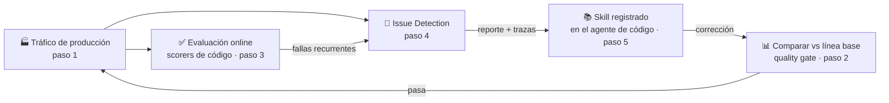

🌐 [English](README.md) | **Español**

# 🧪 Laboratorio: novedades de MLflow 3.18 para GenAIOps

Este laboratorio extiende el chatbot de RR.HH. del repositorio con las cuatro funciones
principales de [MLflow 3.18](https://mlflow.org/releases/) y las conecta en un solo ciclo.
Todo funciona en español (`APP_LANG=es`, por defecto) y en inglés (`APP_LANG=en`): preguntas,
respuestas del agente, mensajes de consola y dataset.



| Paso | Novedad de MLflow 3.18 | Script | ¿API key? | ¿Docker? |
|---|---|---|---|---|
| 1 | — (genera trazas con fallas sembradas) | `step1_traffic.py` | No | No |
| 2 | 📊 **Comparación de evaluaciones** (`compare_evaluations`, `assert_improved`) | `step2_compare.py`, `test_gate.py` | No | No |
| 3 | ✅ **Evaluación online con scorers de código** (`.register()` + `.start()`) | `step3_online.py` | No | **Sí** |
| 4 | 🔎 **Automatic Issue Detection** (pestaña *Issues*) + API de issues | UI + `step4_issues.py` | **Sí** (solo la detección) | No |
| 5 | 📚 **Agent Skill Registry** (registrar, alias, buscar, instalar) | `step5_skills.py` | No | No |

> ⚠️ El Skill Registry y la evaluación online con scorers de código son **experimentales** en 3.18.

---

## 🤖 El agente simulado (`mock_agent.py`)

Para practicar sin gastar cuota, el laboratorio trae un asistente simulado que produce trazas
realistas (`AGENT → RETRIEVER → TOOL → CHAT_MODEL`, con tokens) y tiene **tres versiones**:

| Versión | Comportamiento |
|---|---|
| `v1` verboso | Respuestas largas sin fuente; **inventa políticas** cuando no sabe; **repite correos/teléfonos**; la herramienta de saldo de vacaciones **siempre falla**; **lento** en comparaciones; envía ~20x más tokens; responde en el otro idioma si le preguntan en él |
| `v2` conciso | Cita la fuente y se abstiene... pero **recorta la respuesta y pierde datos clave** en preguntas de varias partes |
| `v3` corregido | Conciso, cita la fuente, se abstiene y conserva todos los datos |

Los pasos 1 y 2 aceptan `--agent rag` para usar en su lugar el RAG real del repositorio
(necesita el índice FAISS y `OPENAI_API_KEY` o `GROQ_API_KEY`, ver el [README principal](../../README.es.md)).

---

## ⚙️ Preparación

```bash
pip install -r labs/mlflow_318/requirements.txt
./labs/mlflow_318/start_server.sh            # con Docker (todo el laboratorio)
# ./labs/mlflow_318/start_server.sh --no-docker   # sin Docker: todo menos el paso 3
```

Abre <http://localhost:5000>. El servidor usa SQLite (`mlflow_lab318.db`), ejecución de jobs
en segundo plano y, con Docker, contenedores aislados para los scorers de código.
Los scripts usan `MLFLOW_TRACKING_URI` si está definida; si no, `http://localhost:5000`.
El idioma sale de `APP_LANG` (en `.env` o en la terminal).

---

## Paso 1 · Tráfico de "producción"

```bash
python labs/mlflow_318/step1_traffic.py            # 38 trazas de v1, en sesiones de 1 a 3 turnos
```
**Observa:** *Experiments → `lab318_production` → Traces* y la vista de **Sessions**. Abre una
traza de "saldo de vacaciones": el span `check_vacation_balance` está en rojo.

## Paso 2 · Comparar contra una línea base

Un promedio más alto puede esconder respuestas que empeoraron.

```bash
python labs/mlflow_318/step2_compare.py                         # v1 (base) vs v2
```
**Observa:** la tabla de `compare_evaluations()` (prueba pareada por pregunta: McNemar para
scorers binarios, Wilcoxon para numéricos, intervalo de confianza y p-value). `v2` mejora con
significancia en `cites_source`, `concise_answer` y `answer_length`... y `covers_key_facts`
**empeora** en 7 preguntas. El script lista cada una con sus dos trazas.

En la UI: *`lab318_evaluations` → Evaluation runs →* selecciona los dos runs → **Compare**,
fija la línea base y filtra los ejemplos en regresión para ver la diferencia de respuesta y de
pasos de la traza.

Ahora la versión corregida, con el *quality gate*:
```bash
python labs/mlflow_318/step2_compare.py --candidate v3 --gate   # ✅ pasa
pytest labs/mlflow_318/test_gate.py -v                           # el mismo gate en pytest / CI
```

El gate (`gate.py`) tiene dos reglas:
1. **Mejora significativa** en los scorers objetivo → `ComparisonResult.assert_improved()`.
2. **Ninguna pregunta peor** en los scorers "guardianes" → `ComparisonResult.paired_rows`.

Se configura con `GATE_IMPROVE`, `GATE_GUARD`, `GATE_TOLERANCE` y `GATE_ALPHA`.
El workflow [`mlflow318-lab.yml`](../../.github/workflows/mlflow318-lab.yml) lo ejecuta en
español e inglés en cada cambio: verifica que **v2 sea bloqueada** y que **v3 pase**.

Con el RAG real (prompt v1 vs v2 del Prompt Registry, más jueces LLM):
```bash
python labs/mlflow_318/step2_compare.py --agent rag \
  --baseline prompts:/asistente_rrhh/1 --candidate prompts:/asistente_rrhh/2 --judges
```

> 💡 **Cómo empareja las filas:** por el ID de la fila del dataset y, si no existe, por el hash
> de las entradas de la traza raíz. Por eso `answer()` no recibe la versión como argumento
> (se fija con `configure()`): si la versión fuera parte de las entradas, ninguna fila de v1
> encontraría su par en v2. Con un dataset de evaluación de MLflow el emparejamiento es por ID.
> Con menos de 6 pares un scorer queda como `insufficient_pairs`.

## Paso 3 · Evaluación online con scorers de código (Docker)

```bash
python labs/mlflow_318/step3_online.py               # registra los scorers de scorers.py y llama .start()
python labs/mlflow_318/step1_traffic.py --repeat 1   # tráfico nuevo
python labs/mlflow_318/step3_online.py --status
```
**Observa:** las trazas nuevas reciben evaluaciones con fuente **CODE** (`concise_answer`,
`cites_source`, `no_personal_data`, `no_tool_errors`) y cada sesión recibe
`session_without_failures` (scorer de sesión: recibe `session`, la lista de trazas de la conversación).

Reglas que impone 3.18 (por eso `scorers.py` se ve así):
- solo funciones `@scorer` definidas con `def` (no lambdas, ni `async`, ni la clase `Scorer`);
- los `import` van **dentro** de la función: el servidor ejecuta el código fuente en un contenedor **sin red**;
- la evaluación automática no acepta scorers con `expectations`;
- requiere servidor con base de datos, Docker local (no *rootless*), una sola réplica y
  `MLFLOW_SERVER_ENABLE_CUSTOM_SCORERS=true` también en el cliente.

Opciones: `--sample-rate 0.3`, `--filter "tags.environment = 'production'"` (por defecto), `--stop`.

> En macOS con Colima, `start_server.sh` ya mueve `TMPDIR` a tu home. En Codespaces agrega la
> *feature* `docker-in-docker` al devcontainer. No definas `MLFLOW_JOB_IMAGE` con una imagen que
> no tengas localmente: el servidor intentará descargarla y se detendrá. Sin esa variable, MLflow
> construye su propia imagen mínima al arrancar.

## Paso 4 · Automatic Issue Detection

1. En la UI: *`lab318_production` → **Issues** → Run issue detection*.
2. Elige proveedor y modelo (OpenAI, Anthropic, Gemini o un endpoint del AI Gateway), revisa
   las trazas seleccionadas y el costo estimado → **Run Analysis**.
3. Deberían aparecer los problemas sembrados en v1: políticas inventadas, la herramienta que
   falla, respuestas lentas en comparaciones, costo de tokens y datos personales repetidos.
   Marca como **Not an issue** lo que no aplique.
4. **Schedule detection**: diaria o semanal, con filtro `environment = production`.

Luego, desde código:
```bash
python labs/mlflow_318/step4_issues.py                            # lista + issues_for_agent.md
python labs/mlflow_318/step4_issues.py --from-scorer cites_source   # issue a partir del paso 3
python labs/mlflow_318/step4_issues.py --resolve <ISSUE_ID>
```
`issues_for_agent.md` resume cada issue con sus trazas de ejemplo para pegarlo en tu agente de
código. En la UI, cada issue tiene **Fix this issue → Copy** con un prompt listo.

## Paso 5 · Agent Skill Registry

```bash
python labs/mlflow_318/step5_skills.py
```
Registra [`skills/genaiops-hr-triage`](skills/genaiops-hr-triage/SKILL.md) (cómo investigar
un issue en las trazas, corregirlo y **demostrarlo con el paso 2** antes de cerrarlo), le asigna
el alias `@production`, lo busca en el registro y lo instala en `.claude/skills/` para Claude Code.
Cada ejecución crea una versión nueva. Para otro agente: `--dest .cursor/skills/genaiops-hr-triage`.
El skill está escrito en inglés (lo lee el agente) y le pide responder en el idioma del usuario.

Equivalente con la CLI:
```bash
mlflow skills register --source labs/mlflow_318/skills/genaiops-hr-triage
mlflow skills set-alias skills:/genaiops-hr-triage --alias production --version 1
mlflow skills search --filter-string "status = 'active'"
mlflow skills pull skills:/genaiops-hr-triage@production -d .claude/skills/genaiops-hr-triage
```

**Cierra el ciclo:** abre Claude Code en el repo y pide *"usa el skill genaiops-hr-triage para
resolver los issues de labs/mlflow_318/issues_for_agent.md"*.

---

## 🎓 Retos

1. Crea `v4` en `mock_agent.py` que además nunca repita datos personales y demuestra con el paso 2
   que mejora a `v3` sin regresiones. Agrega `no_personal_data` a `GATE_IMPROVE`.
2. Escribe un scorer online `acceptable_latency(trace)` (menos de 1 s) y verifica que la detección
   de issues y tu scorer coinciden sobre las comparaciones lentas.
3. Compara dos prompts reales del Prompt Registry con `--agent rag --judges` y decide cuál
   promover con `python -m app.prompt_registry --promote N`.
4. Agrega al skill una sección para issues de costo (tokens) y publícala como v2 con alias `@staging`.

## 📁 Archivos

| Archivo | Qué contiene |
|---|---|
| `start_server.sh` | Servidor MLflow 3.18 con jobs, tareas periódicas y Docker |
| `config.py` | Tracking URI, experimentos, idioma y rutas compartidas |
| `texts.py` | Mensajes del laboratorio en español e inglés |
| `mock_agent.py` | Asistente simulado v1/v2/v3 con fallas sembradas, en los dos idiomas |
| `scorers.py` | Scorers de código (online y offline) |
| `gate.py` / `test_gate.py` | Quality gate sobre `compare_evaluations` |
| `data/lab_questions.es.json` / `.en.json` | 14 preguntas con respuesta esperada y datos clave |
| `skills/genaiops-hr-triage/` | Skill para agentes de código |
| `step1…step5_*.py` | Un script por paso |

Docs: [Issue detection](https://mlflow.org/docs/latest/genai/eval-monitor/ai-insights/detect-issues/) ·
[Comparing evaluation runs](https://mlflow.org/docs/latest/genai/eval-monitor/comparing-evaluation-runs/) ·
[Job containers](https://mlflow.org/docs/latest/self-hosting/job-containers/) ·
[Skill Registry](https://mlflow.org/docs/latest/genai/skill-registry/)
