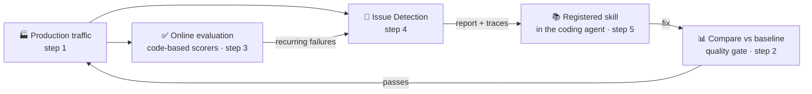

🌐 **English** | [Español](README.es.md)

# 🧪 Lab: what's new in MLflow 3.18 for GenAIOps

This lab extends the repo's HR chatbot with the four headline features of
[MLflow 3.18](https://mlflow.org/releases/) and connects them in a single cycle.
Everything works in English (`APP_LANG=en`) and in Spanish (`APP_LANG=es`, the default):
questions, agent answers, console messages and dataset.



| Step | New in MLflow 3.18 | Script | API key? | Docker? |
|---|---|---|---|---|
| 1 | — (generates traces with planted failures) | `step1_traffic.py` | No | No |
| 2 | 📊 **Evaluation comparison** (`compare_evaluations`, `assert_improved`) | `step2_compare.py`, `test_gate.py` | No | No |
| 3 | ✅ **Online evaluation with code-based scorers** (`.register()` + `.start()`) | `step3_online.py` | No | **Yes** |
| 4 | 🔎 **Automatic Issue Detection** (*Issues* tab) + issues API | UI + `step4_issues.py` | **Yes** (detection only) | No |
| 5 | 📚 **Agent Skill Registry** (register, alias, search, install) | `step5_skills.py` | No | No |

> ⚠️ The Skill Registry and online evaluation with code-based scorers are **experimental** in 3.18.

---

## 🤖 The simulated agent (`mock_agent.py`)

To practice without spending quota, the lab ships a simulated assistant that produces realistic
traces (`AGENT → RETRIEVER → TOOL → CHAT_MODEL`, with tokens) and has **three versions**:

| Version | Behavior |
|---|---|
| `v1` verbose | Long answers with no source; **makes up policies** when it does not know; **echoes emails/phone numbers**; the vacation balance tool **always fails**; **slow** on comparisons; sends ~20x more tokens; answers in the other language when asked in it |
| `v2` concise | Cites its source and abstains... but **cuts the answer and loses key facts** on multi-part questions |
| `v3` fixed | Concise, cites its source, abstains and keeps every fact |

Steps 1 and 2 accept `--agent rag` to use the repo's real RAG instead
(needs the FAISS index and `OPENAI_API_KEY` or `GROQ_API_KEY`, see the [main README](../../README.md)).

---

## ⚙️ Setup

```bash
pip install -r labs/mlflow_318/requirements.txt
export APP_LANG=en                           # or put APP_LANG=en in .env
./labs/mlflow_318/start_server.sh            # with Docker (the whole lab)
# ./labs/mlflow_318/start_server.sh --no-docker   # without Docker: everything but step 3
```

Open <http://localhost:5000>. The server uses SQLite (`mlflow_lab318.db`), background job
execution and, with Docker, isolated containers for the code-based scorers.
The scripts use `MLFLOW_TRACKING_URI` if it is set; otherwise `http://localhost:5000`.
The language comes from `APP_LANG` (in `.env` or the terminal).

---

## Step 1 · "Production" traffic

```bash
python labs/mlflow_318/step1_traffic.py            # 38 v1 traces, in sessions of 1 to 3 turns
```
**Observe:** *Experiments → `lab318_production` → Traces* and the **Sessions** view. Open a
"vacation balance" trace: the `check_vacation_balance` span is red.

## Step 2 · Compare against a baseline

A higher average can hide answers that got worse.

```bash
python labs/mlflow_318/step2_compare.py                         # v1 (baseline) vs v2
```
**Observe:** the `compare_evaluations()` table (paired test per question: McNemar for binary
scorers, Wilcoxon for numeric ones, confidence interval and p-value). In English, `v2` improves
significantly on `cites_source` and `answer_length`, and `concise_answer` goes up without reaching
significance... while `covers_key_facts` **gets worse** on 7 questions. The script lists each one
with its two traces.

In the UI: *`lab318_evaluations` → Evaluation runs →* select both runs → **Compare**, pin the
baseline and filter to regressed examples to see how the response and the trace steps changed.

Now the fixed version, with the *quality gate*:
```bash
python labs/mlflow_318/step2_compare.py --candidate v3 --gate   # ✅ passes
pytest labs/mlflow_318/test_gate.py -v                           # the same gate in pytest / CI
```

The gate (`gate.py`) has two rules:
1. **Significant improvement** on the target scorers → `ComparisonResult.assert_improved()`.
2. **No question worse** on the "guard" scorers → `ComparisonResult.paired_rows`.

It is configured with `GATE_IMPROVE`, `GATE_GUARD`, `GATE_TOLERANCE` and `GATE_ALPHA`.
The [`mlflow318-lab.yml`](../../.github/workflows/mlflow318-lab.yml) workflow runs it in English
and Spanish on every change: it checks that **v2 is blocked** and **v3 passes**.

With the real RAG (prompt v1 vs v2 from the Prompt Registry, plus LLM judges):
```bash
python labs/mlflow_318/step2_compare.py --agent rag \
  --baseline prompts:/hr_assistant/1 --candidate prompts:/hr_assistant/2 --judges
```

> 💡 **How rows are paired:** by the dataset row ID and, when there is none, by a hash of the
> root trace's inputs. That is why `answer()` does not take the version as an argument (it is
> set with `configure()`): if the version were part of the inputs, no v1 row would find its v2
> pair. With an MLflow evaluation dataset, pairing is by ID. With fewer than 6 pairs a scorer
> comes back as `insufficient_pairs`.

## Step 3 · Online evaluation with code-based scorers (Docker)

```bash
python labs/mlflow_318/step3_online.py               # registers the scorers in scorers.py and calls .start()
python labs/mlflow_318/step1_traffic.py --repeat 1   # new traffic
python labs/mlflow_318/step3_online.py --status
```
**Observe:** new traces get assessments with source **CODE** (`concise_answer`,
`cites_source`, `no_personal_data`, `no_tool_errors`) and each session gets
`session_without_failures` (a session-level scorer: it receives `session`, the list of the conversation's traces).

Rules 3.18 enforces (which is why `scorers.py` looks the way it does):
- only `@scorer` functions defined with `def` (no lambdas, no `async`, no `Scorer` class);
- `import`s go **inside** the function: the server runs the source code in a container **with no network**;
- automatic evaluation does not accept scorers that take `expectations`;
- it needs a server with a database, local Docker (not *rootless*), a single replica and
  `MLFLOW_SERVER_ENABLE_CUSTOM_SCORERS=true` on the client too.

Options: `--sample-rate 0.3`, `--filter "tags.environment = 'production'"` (default), `--stop`.

> On macOS with Colima, `start_server.sh` already moves `TMPDIR` into your home. In Codespaces add
> the `docker-in-docker` feature to the devcontainer. Do not set `MLFLOW_JOB_IMAGE` to an image you
> do not have locally: the server will try to pull it and stop. Without that variable, MLflow builds
> its own minimal image at startup.

## Step 4 · Automatic Issue Detection

1. In the UI: *`lab318_production` → **Issues** → Run issue detection*.
2. Pick the provider and model (OpenAI, Anthropic, Gemini or an AI Gateway endpoint), review the
   selected traces and the estimated cost → **Run Analysis**.
3. The failures planted in v1 should show up: made-up policies, the failing tool, slow answers on
   comparisons, token cost and echoed personal data. Mark what does not apply as **Not an issue**.
4. **Schedule detection**: daily or weekly, with an `environment = production` filter.

Then, from code:
```bash
python labs/mlflow_318/step4_issues.py                             # list + issues_for_agent.md
python labs/mlflow_318/step4_issues.py --from-scorer cites_source   # issue from step 3
python labs/mlflow_318/step4_issues.py --resolve <ISSUE_ID>
```
`issues_for_agent.md` summarizes each issue with sample traces, ready to paste into your coding
agent. In the UI, every issue has **Fix this issue → Copy** with a ready-made prompt.

## Step 5 · Agent Skill Registry

```bash
python labs/mlflow_318/step5_skills.py
```
It registers [`skills/genaiops-hr-triage`](skills/genaiops-hr-triage/SKILL.md) (how to investigate
an issue in the traces, fix it and **prove it with step 2** before closing it), points the
`@production` alias at it, finds it in the registry and installs it into `.claude/skills/` for
Claude Code. Every run creates a new version. For another agent: `--dest .cursor/skills/genaiops-hr-triage`.
The skill is written in English (the agent reads it) and tells the agent to answer in the user's language.

Same thing with the CLI:
```bash
mlflow skills register --source labs/mlflow_318/skills/genaiops-hr-triage
mlflow skills set-alias skills:/genaiops-hr-triage --alias production --version 1
mlflow skills search --filter-string "status = 'active'"
mlflow skills pull skills:/genaiops-hr-triage@production -d .claude/skills/genaiops-hr-triage
```

**Close the loop:** open Claude Code in the repo and ask *"use the genaiops-hr-triage skill to
fix the issues in labs/mlflow_318/issues_for_agent.md"*.

---

## 🎓 Challenges

1. Create `v4` in `mock_agent.py` that also never echoes personal data, and prove with step 2
   that it improves on `v3` with no regressions. Add `no_personal_data` to `GATE_IMPROVE`.
2. Write an online scorer `acceptable_latency(trace)` (under 1 s) and check that issue detection
   and your scorer agree on the slow comparisons.
3. Compare two real prompts from the Prompt Registry with `--agent rag --judges` and decide which
   one to promote with `python -m app.prompt_registry --promote N`.
4. Add a section for cost (token) issues to the skill and publish it as v2 with a `@staging` alias.

## 📁 Files

| File | What it contains |
|---|---|
| `start_server.sh` | MLflow 3.18 server with jobs, periodic tasks and Docker |
| `config.py` | Shared tracking URI, experiments, language and paths |
| `texts.py` | Lab messages in English and Spanish |
| `mock_agent.py` | Simulated assistant v1/v2/v3 with planted failures, in both languages |
| `scorers.py` | Code-based scorers (online and offline) |
| `gate.py` / `test_gate.py` | Quality gate on `compare_evaluations` |
| `data/lab_questions.en.json` / `.es.json` | 14 questions with expected answer and key facts |
| `skills/genaiops-hr-triage/` | Skill for coding agents |
| `step1…step5_*.py` | One script per step |

Docs: [Issue detection](https://mlflow.org/docs/latest/genai/eval-monitor/ai-insights/detect-issues/) ·
[Comparing evaluation runs](https://mlflow.org/docs/latest/genai/eval-monitor/comparing-evaluation-runs/) ·
[Job containers](https://mlflow.org/docs/latest/self-hosting/job-containers/) ·
[Skill Registry](https://mlflow.org/docs/latest/genai/skill-registry/)
